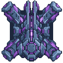
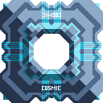

# Cosmic Vanilla Distribution

This page lists the Cosmic Vanilla blocks that move, route, bridge, or store items and liquids. `Input` describes ongoing operating resources or what the block accepts; it does not repeat construction or research costs.

Only each block's default sprite is shown. Conveyor connection frames, bridge endpoints and arrows, stack overlays, liquid fills, glow layers, and router bottoms are deliberately omitted. Conduit entries use their default `-top-0` connection frame.

## Conveyor and stack transport

| Picture | Name | Input | Output |
| --- | --- | --- | --- |
| 

 | Solar Conveyor | Items from its back; no power. | Moves items forward at 16 items/s. |
| 

 | Supernova Conveyor | Items from its back; no power. | Moves items forward at 21 items/s. |
| 

 | Void Conveyor | Items from its back; no power. | Moves items forward at 26 items/s. |
| 

 | Stellar Stack Conveyor | Items from its back; power 4/s. | Moves 25-item stacks; rated 100 items/s. |
| 

 | Stellar Stack Router | Item stacks; power 6/s. | Distributes a full 25-item stack in a burst to connected outputs. |

## Item routing and crossing

| Picture | Name | Input | Output |
| --- | --- | --- | --- |
| 

 | Cosmic Router | Items from connected sides; no power. | Evenly distributes items among eligible outputs. |
| 

 | Cosmic Junction | Two intersecting item streams; no power. | Passes streams across without mixing; displayed speed 26 items/s. |

## Item bridges and long-range launch

| Picture | Name | Input | Output |
| --- | --- | --- | --- |
| 

 | Celestial Bridge | Linked bridge; items; no power. | Bridges items up to 25 tiles; 30-item buffer; displayed speed 15 items/s. |
| 

 | Interstellar Hyperlane | Linked hyperlane; items; power 33/s. | Bridges items up to 50 tiles; 50-item capacity; 2.3-tick transport interval. |
| 

 | Quasar Mass Driver | Items; power 360/s; a receiving Quasar Mass Driver in range. | Launches shipments of at least 50 items, up to 250 stored, across 1,320 tiles. |

## Liquid conduits

| Picture | Name | Input | Output |
| --- | --- | --- | --- |
| 

 | Solar Conduit | Any liquid from the previous conduit; no power. | Sends liquid forward; 30 liquid capacity; pressure 1.25. |
| 

 | Supernova Conduit | Any liquid from the previous conduit; no power. | Sends liquid forward; 60 liquid capacity; pressure 1.75. |
| 

 | Void Conduit | Any liquid from the previous conduit; no power. | Sends liquid forward; 100 liquid capacity; pressure 2.5. |

## Liquid routing and storage

| Picture | Name | Input | Output |
| --- | --- | --- | --- |
| 

 | Cosmic Liquid Router | Any connected liquid stream; no power. | Evenly distributes liquid among valid outputs; 300 liquid capacity. |
| 

 | Cosmic Liquid Junction | Two intersecting liquid streams; no power. | Passes streams across without interference. |
| 

 | Celestial Reservoir | Any connected liquid stream; no power. | Stores and routes up to 13,500 liquid. |

## Liquid bridges

| Picture | Name | Input | Output |
| --- | --- | --- | --- |
| 

 | Celestial Aqueduct | Linked aqueduct; any liquid; no power. | Bridges liquid up to 25 tiles; 150 liquid capacity; pressure 1.1. |
| 

 | Voidstream Hyperlane | Linked hyperlane; any liquid; power 33/s. | Bridges liquid up to 50 tiles; 300 liquid capacity; pressure 1.2. |

