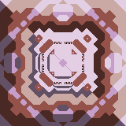

# Cosmic Vanilla Extractors

This catalogue covers blocks that take materials directly from the map: tile drills, wall bores, wall crafters, and liquid pumps. `Input` means ongoing operating input. Construction and research costs are documented in the block HJSON and balance guides, not duplicated here.

Every drill-family picture is a documentation preview composited from the block’s existing layers in Mindustry draw order. Standard drills use base, rotator, and top; WallCrafters additionally use `-rotator-bottom` beneath the base. These previews are not game sprites, do not alter any source artwork, and intentionally omit glow layers.

Rates assume full valid ore or wall coverage. Standard drills and mini drills output the mineable ore below their footprint; beam bores output the mineable ore in their valid wall-facing beams. Their liquid booster is optional and increases speed by the configured boost intensity.

## Drill — standard Cosmic I–VIII line

| Picture | Name | Input | Output |
| --- | --- | --- | --- |
| 

 | Cosmic Drill (I) | Optional water 4.8/s; 1.65× liquid boost. | Mineable floor ore, 0.80 items/s. |
| 

 | Cosmic II Drill | Optional water 6/s; 1.75× liquid boost. | Mineable floor ore, 1.00 items/s. |
| 

 | Cosmic III Drill | Optional water 7.2/s; 1.85× liquid boost. | Mineable floor ore, 1.26 items/s. |
| 

 | Cosmic IV Drill | Optional water 8.4/s; 1.95× liquid boost. | Mineable floor ore, 1.60 items/s. |
| 

 | Cosmic V Drill | Optional water 9.6/s; 2.05× liquid boost. | Mineable floor ore, 2.00 items/s. |
| 

 | Cosmic VI Drill | Optional water 10.8/s; 2.15× liquid boost. | Mineable floor ore, 2.40 items/s. |
| 

 | Cosmic VII Drill | Optional water 12/s; 2.25× liquid boost. | Mineable floor ore, 3.00 items/s. |
| 

 | Cosmic VIII Drill | Optional water 13.2/s; 2.35× liquid boost. | Mineable floor ore, 3.69 items/s. |

## Drill — mini Cosmic I–VIII line

| Picture | Name | Input | Output |
| --- | --- | --- | --- |
| 

 | mini Cosmic Drill (I) | Optional water 4.8/s; 1.65× liquid boost. | Mineable floor ore, 0.27 items/s. |
| 

 | mini Cosmic II Drill | Optional water 6/s; 1.75× liquid boost. | Mineable floor ore, 0.34 items/s. |
| 

 | mini Cosmic III Drill | Optional water 7.2/s; 1.85× liquid boost. | Mineable floor ore, 0.43 items/s. |
| 

 | mini Cosmic IV Drill | Optional water 8.4/s; 1.95× liquid boost. | Mineable floor ore, 0.55 items/s. |
| 

 | mini Cosmic V Drill | Optional water 9.6/s; 2.05× liquid boost. | Mineable floor ore, 0.67 items/s. |
| 

 | mini Cosmic VI Drill | Optional water 10.8/s; 2.15× liquid boost. | Mineable floor ore, 0.80 items/s. |
| 

 | mini Cosmic VII Drill | Optional water 12/s; 2.25× liquid boost. | Mineable floor ore, 1.00 items/s. |
| 

 | mini Cosmic VIII Drill | Optional water 13.2/s; 2.35× liquid boost. | Mineable floor ore, 1.20 items/s. |

## Drill and BurstDrill — advanced floor extraction

| Picture | Name | Input | Output |
| --- | --- | --- | --- |
| 

 | Cosmic Drill Pro | Power 18/s; optional cryofluid 14.4/s; 2.45× liquid boost. | Mineable floor ore, 10.38 items/s. |
| 

 | Cosmic Drill Pro Max | Power 25.8/s; optional cryofluid 15.6/s; 2.55× liquid boost. | Mineable floor ore, 22.86 items/s. |
| 

 | Supernova Drill | Power 18/s; cryofluid 36/s; slag 36/s. | Mineable floor ore, 20.53 items/s. |

## BeamDrill — wall bores

| Picture | Name | Input | Output |
| --- | --- | --- | --- |
| 

 | Cosmic Prism Bore | Power 48/s; optional neoplasm 7.8/s; 1.5× liquid boost. | Mineable ore on valid wall frontage, 1.50 items/s. |
| 

 | Cosmic Radiant Bore | Power 60/s; optional neoplasm 9.6/s; 1.88× liquid boost. | Mineable ore on valid wall frontage, 2.81 items/s. |
| 

 | Cosmic Spectral Bore | Power 75/s; optional neoplasm 12/s; 2.35× liquid boost. | Mineable ore on valid wall frontage, 4.71 items/s. |
| 

 | Cosmic Photon Bore | Power 93.6/s; optional neoplasm 15/s; 2.94× liquid boost. | Mineable ore on valid wall frontage, 7.32 items/s. |

## WallCrafter — Rift Fracturers

All Rift Fracturers require a valid sand-attribute wall on their working frontage. Their output is fixed by the block; the wall does not determine whether titanium, thorium, beryllium, or tungsten is produced.

| Picture | Name | Input | Output |
| --- | --- | --- | --- |
| 

 | Titanium Rift Fracturer | Power 45/s; optional water 14.4/s; 1.6× liquid boost. | Titanium, 4.36 items/s. |
| 

 | Thorium Rift Fracturer | Power 51/s; optional water 14.4/s; 1.6× liquid boost. | Thorium, 4.00 items/s. |
| 

 | Beryllium Rift Fracturer | Power 54/s; optional water 15.6/s; 1.6× liquid boost. | Beryllium, 4.36 items/s. |
| 

 | Tungsten Rift Fracturer | Power 66/s; optional water 16.8/s; 1.6× liquid boost. | Tungsten, 4.80 items/s. |

## Pump — liquid extraction

Pumps do not have a predetermined liquid output: they extract the valid liquid below their footprint.

| Picture | Name | Input | Output |
| --- | --- | --- | --- |
| 

 | Pulsar Liquid Pump | No ongoing resource input; must cover valid liquid tiles. | Liquid under each valid tile, 25 liquid/s per tile. |
| 

 | Quasar Liquid Pump | No ongoing resource input; must cover valid liquid tiles. | Liquid under each valid tile, 100 liquid/s per tile. |

