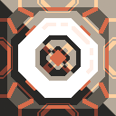
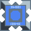

# Cosmic Vanilla Power

This page lists Cosmic Vanilla power blocks. The Entropy Furnace generates power from one eligible solid item at a time; the Nullstar Reactor is a warmup-based, high-output Impact Reactor; the Synchrotron Nodes distribute an existing network and do not generate, consume, or store power.

| Picture | Name | Input | Output |
| --- | --- | --- | --- |
| 

 | Entropy Furnace | One ordinary vanilla solid item per fuel cycle. Slag must be exported. | Fixed 300 power/second while active; fuel changes the 0.2–2 second total-energy cycle. Produces 4 slag/second, and a full buffer destroys it. |
| 

 | Pyroclast Dynamo | 2 pyratite and 1 graphite every 1.5 seconds. | 360 power/second while fueled. |
| 

 | Exergonic Reactor | 1 graphite and 1 oxide every 2 seconds. | 420 power/second while fueled. |
| 

 | Nullstar Reactor | 2 thorium + 2 blast compound every 3 seconds; cryofluid 30/s; nitrogen 18/s; external power 6,000/s. | 23,400 power/second gross; 17,400/s net at full warmup. All inputs and near-full incoming power are mandatory. |
| 

 | Synchrotron Node | Existing compatible power network; no resource consumption. | Links up to 25 compatible nodes or powered blocks within 30 tiles. |
| 

 | Synchrotron Node II | Existing compatible power network; no resource consumption. | Links up to 5 compatible nodes or powered blocks within 60 tiles. |

Both nodes are shown on Serpulo and Erekir after their single Cosmic-tree research node is unlocked. Erekir `BeamNode` blocks use their separate native directional-beam rules; this page does not claim direct BeamNode-to-PowerNode interoperability.
