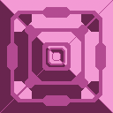

# Cosmic Vanilla Shields

This page documents the Cosmic Vanilla shield-wall family. These are `ShieldWall` blocks: each has structural health and armor plus a separate regenerating shield that requires power. Pictures use only the default main sprite; glow overlays are intentionally omitted.

`Input` is the ongoing power requirement. `Output` describes the defensive protection the block provides rather than a crafted resource.

## ShieldWall — Event Horizon family

| Picture | Name | Input | Output |
| --- | --- | --- | --- |
| 

 | Event Horizon Wall | Power 2.25/s. | 810 health; 40 armor; 675 shield health; regenerates 1.5 shield/s. Absorbs lasers, reflects eligible projectiles, retaliates with lightning, and insulates against power connections. Shield recovers after a 400-tick break cooldown. |
| 

 | Large Event Horizon Wall | Power 9/s. | 3,240 health; 40 armor; 2,700 shield health; regenerates 6 shield/s. Absorbs lasers, reflects eligible projectiles, retaliates with lightning, and insulates against power connections. Shield recovers after a 400-tick break cooldown. |
| 

 | Colossal Event Horizon Wall | Power 36/s. | 12,960 health; 40 armor; 10,800 shield health; regenerates 24 shield/s. Absorbs lasers, reflects eligible projectiles, retaliates with lightning, and insulates against power connections. Shield recovers after a 400-tick break cooldown. |

## Shared defensive behavior

- **Laser absorption:** Incoming lasers are absorbed while the wall can protect itself.
- **Projectile deflection:** The `chanceDeflect: 30` setting is evaluated against the incoming bullet damage; it is not a flat 30% deflection chance.
- **Lightning retaliation:** Each successful damaging hit has a 15% chance to create 90-damage lightning with a maximum length of 51 tiles.
- **Shield interruption:** If the shield is depleted, it remains broken for 400 ticks before regeneration resumes. The wall’s structural health and armor remain active throughout.

